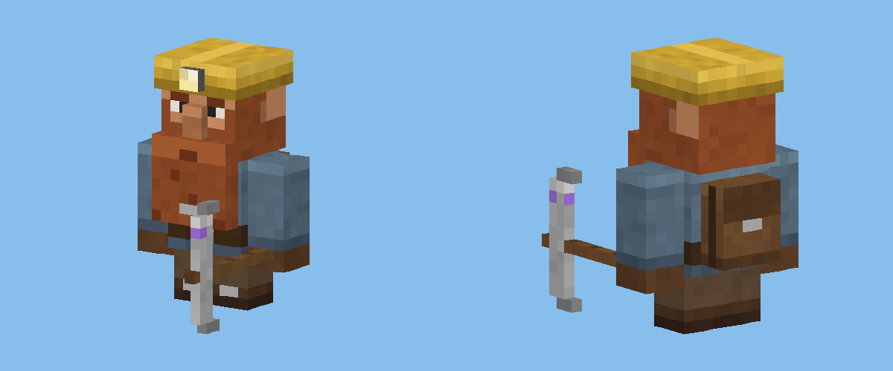
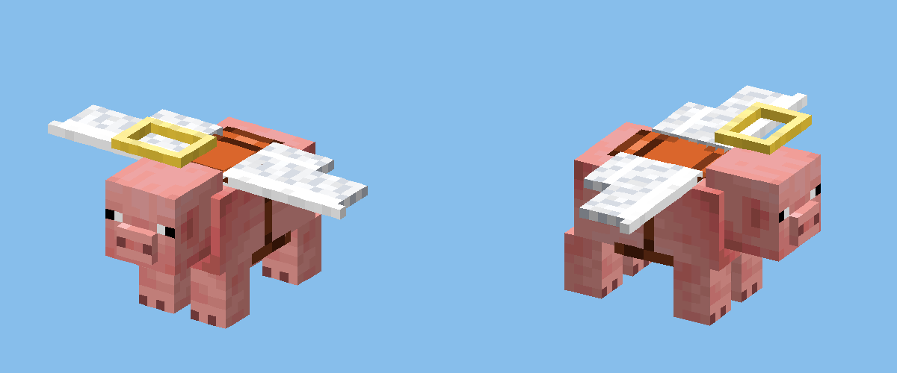

Рай — измерение с парящими островами из кальцита. На одних островах растут высокие берёзы, на других возвышаются аметистовые шпили. Между островами висят облака, по которым можно ходить.

## Как попасть и вернуться

1. Построй в Верхнем мире вертикальную рамку из светокамня. Минимальный проём — 2 блока в ширину и 3 в высоту; углы не обязательны.
2. Вылей ведро воды внутрь рамки. Если Рай открыт на сервере, постой в портале несколько секунд.
3. Чтобы вернуться, выйди из портала и зайди в него снова. Координаты X и Z не делятся на восемь.

*Портал в Рай: светокамень вместо обсидиана, вода вместо огня.*

Если упадёшь ниже островов, окажешься в небе Верхнего мира над теми же координатами. Перед землёй падение замедлится. На элитрах можно продолжить полёт.

Поставить кровать в Раю можно, но при попытке лечь она растает. Взрыва не будет, а точка возрождения не изменится.

## Что искать на островах

- Целые кварцевые алтари отличаются от руин берёзовой надстройкой и четырьмя сундуками. В них бывает книга «Познание»: зачарованное оружие даёт больше опыта за убийство мобов.
- Дом дворфов на вершине острова скрывает лестницу к подземелью. В кладовых встречаются зачарованные кирки и шлем с «Амортизацией», который смягчает удар о стену на элитрах, но не обычное падение.
- Серный гейзер подбрасывает вверх, если встать над жерлом. Одни бьют постоянно, другие — с перерывами.
- Из листьев магической травы готовят отвар для дворфов.

## Облачко

*Рецепт четырёх облачков: перо в центре, белая шерсть по четырём сторонам.*

Нажми ПКМ облачком, целясь в пустоту: блок появится в трёх блоках перед глазами. Если смотреть строго вниз — в двух блоках под ногами. Так можно начать мост без опоры. Облачко ломается мгновенно и смягчает падение, как сноп сена.

## Дворфы

В подземельях живут шахтёры, между островами летают дворфы с деревянными крыльями. Если ударить одного, соседи вступятся за него. Зачарованный шлем ищи в сундуках подземелья: с летуна он не выпадает.

*Дворф-шахтёр из MineHouse Paradise: вид спереди и со спины.*

Дай дворфу образец нажатием ПКМ. С сырым железом он ищет железную руду. Можно дать ещё и инструмент:

- Топор + берёзовое бревно — срубит берёзу целиком.
- Мотыга + пшеница — соберёт урожай и снова засеет грядку.
- Ножницы + красная шерсть — пострижёт красных овец.

Добычу собирай сам. Не задавай образец рядом с постройкой из такого же материала: дворф может разобрать её. ПКМ пустой рукой возвращает сначала образец, затем инструмент. Если дать двум дворфам по миске магического отвара, у них может появиться малыш. Обычный дворф и летун тоже могут составить пару.

## Ангельские свиньи

*Ангельская свинья: модель из мода MineHouse. Узнать её можно по крыльям и золотому нимбу.*

Надень седло на взрослую свинью, сядь верхом и возьми удочку с морковкой. Свинья летит туда, куда ты смотришь. ПКМ удочкой даёт рывок. Убери удочку, чтобы зависнуть. Для приманивания и разведения нужна золотая морковь.

## Небесный визер

Призови босса в Раю по схеме ниже. Высоко над островами попадается алтарь с берёзовой беседкой: там уже есть облачка и два черепа.

<table aria-label="Вид спереди. Сложи Т из четырёх облачков и поставь сверху три черепа обычных скелетов, не визер-скелетов."><tbody><tr><td style="text-align:center">Череп</td><td style="text-align:center">Череп</td><td style="text-align:center">Череп</td></tr><tr><td style="text-align:center">Облачко</td><td style="text-align:center">Облачко</td><td style="text-align:center">Облачко</td></tr><tr><td style="text-align:center"> </td><td style="text-align:center">Облачко</td><td style="text-align:center"> </td></tr></tbody></table>

*Вид спереди. Сложи Т из четырёх облачков и поставь сверху три черепа обычных скелетов, не визер-скелетов.*

Если под ногами появилось кольцо частиц, отойди за его край: пол превратится в облака и через три секунды исчезнет. На половине здоровья визер поднимает ураган. Держись подальше от края острова и атакуй в затишье, когда босс подлетает ближе. После победы земля восстановится, а визер оставит Кристалл опыта.

## Хранилище опыта

<table aria-label="Рецепт на верстаке: пять блоков стекла, Кристалл опыта с Небесного визера и три блока аметиста."><tbody><tr><td style="text-align:center">Стекло</td><td style="text-align:center">Стекло</td><td style="text-align:center">Стекло</td></tr><tr><td style="text-align:center">Стекло</td><td style="text-align:center">Кристалл опыта</td><td style="text-align:center">Стекло</td></tr><tr><td style="text-align:center">Блок аметиста</td><td style="text-align:center">Блок аметиста</td><td style="text-align:center">Блок аметиста</td></tr></tbody></table>

*Рецепт на верстаке: пять блоков стекла, Кристалл опыта с Небесного визера и три блока аметиста.*

Открой хранилище нажатием ПКМ и положи осколок аметиста: он даёт 20 зарядов. Выбери режим в верхней центральной ячейке. Под сигналом редстоуна «Приём» забирает опыт у стоящих рядом игроков, а «Выдача» возвращает его сферами.

Бутылочкам редстоун не нужен. «Приём» забирает из них опыт, «Выдача» наполняет пустые. Если сломать и перенести хранилище, опыт останется внутри.
